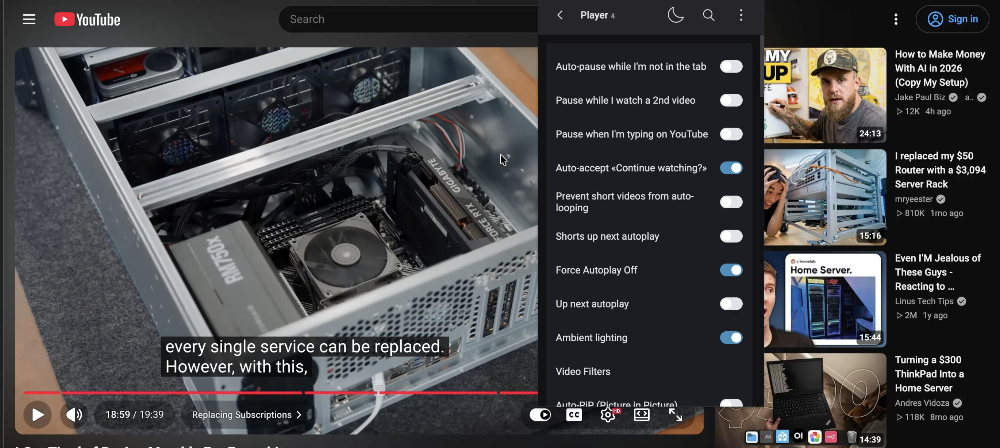
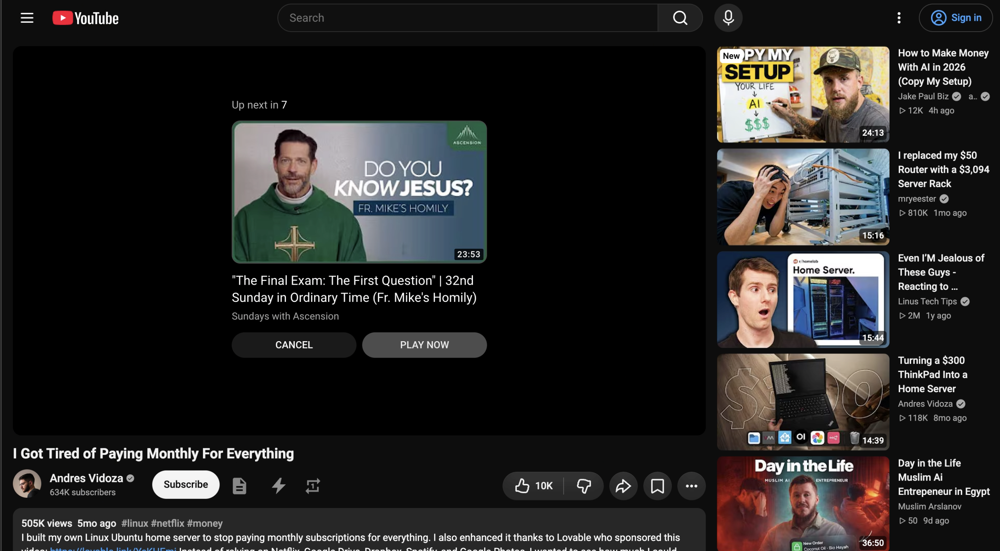
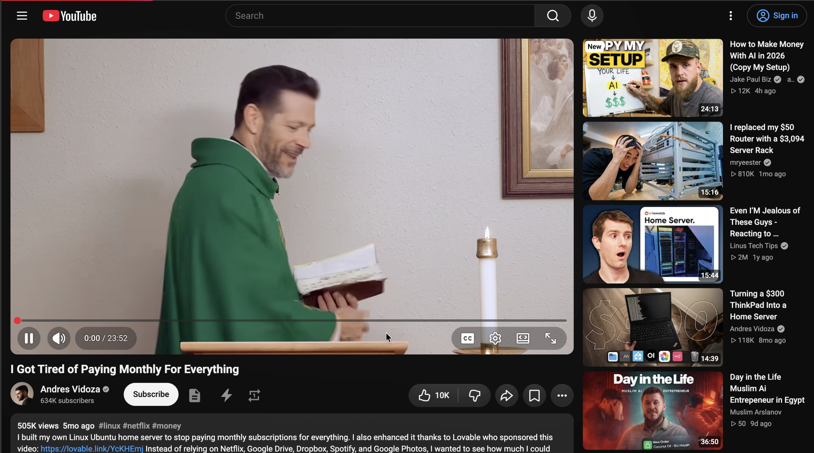
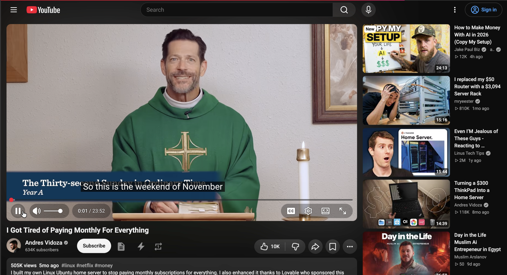

# Contribution: Disable Auto play not working when using incognito

Path: `beat-2-contribution/contribution-story.md`

This file is Assignment 5, and it is graded at the path above; a copy kept anywhere else in
the repository is not read. **Keep every section header below under its exact name** — the
format criteria grade exactly that. Your course repo link is the whole submission: no tool
files and no evidence uploads are part of Assignment 5.

**Contribution Number:** [1]
**Student:** Oscar Cabezas
**GitHub Username:** ocabezas95
**Issue:** https://github.com/code-charity/youtube/issues/4322
**Pull Request:** [GitHub PR link, once opened]

One repository, built across units 5 to 8, telling the whole story of your real
contribution. Fill it as you work, not at the end — the sections below ask for evidence that
is far easier to write down as it happens than to reconstruct in the last weekend.

Contribution Number stays `[1]` unless you make more than one contribution this term; it
just numbers them.

---

## Toolkit

Every story section below, from Why I Chose This Issue through Pull
Request, ends with a Toolkit block: which tool did that phase's work
and how you used it, what it produced, what difficulties or
shortcomings it presented, and what you changed or would change
because of them. Together the blocks are the thread the rubric's
Toolkit points read, and they are the raw material for your unit-9
portfolio, so keep them current as you work rather than
reconstructing them later.

A Toolkit block looks like this (copy it into each story section and
fill it there):

```text
**Toolkit**

- Tool: [which tool did this phase's work, and how you used it]
- What it produced: [described in a sentence or a short excerpt]
- Difficulties: [what fought you or fell short, or "none met"]
- What changed: [the patch, revision, or workaround, what you would
  update, or "nothing"]
```

This section also keeps one short dated entry per week of tool work,
starting below: what you built or changed that week, what broke, and
what you changed because of it. The blocks tell the story where it
happened; these entries are the toolkit's own timeline.

All four entries are graded. Keep every heading below, and fill each
one in the week it belongs to.

**Unit 5: Building and refining my issue-scout**

2026-10-28

I configured issue-scout with four GitHub search queries and ranking rules based on my Python experience and interest in AI projects, documentation, and small fixes. The initial scan rejected all five candidates, showing that search labels and metadata alone did not establish whether an issue was available or manageable. I added `-linked:pr` to all four queries to exclude issues with linked pull requests and tested the updated first query. I also graded two candidates from the CodePath list, `PyVista # 1629` and `PyGMT # 1666`, and their rejections taught me to look for one clearly defined change instead of a broad tracking issue.

**Unit 6: Checking my claim and recording repository context**

2026-11-10

The voice guard stopped my first claim draft because it didn’t show that I had read the discussion and checked whether someone was already working on the issue. I revised it after reviewing the thread, and the updated draft passed. I also created `CLAUDE.local.md` to keep the relevant files and verified test commands together so Claude and I can reuse that context in future sessions. Checking the AI’s incorrect suggestion about separate Incognito extension storage reminded me to verify explanations against documentation and keep possible causes separate from confirmed facts.

**Unit 7: [one line on the tool work]**

[2-4 sentences: the ship-gate and your gate manifest. What it produced
on your real branch, what fought you, what changed because of it.]

**Unit 8: [one line on the tool work]**

[2-4 sentences: the PR-monitor and your playbook. What it read, what it
drafted, what you did with the draft.]

---

## Why I Chose This Issue

2026-11-10

Claim comment: https://github.com/code-charity/youtube/issues/4322#issuecomment-6763260768

I initially used my scout’s GitHub searches to explore candidates, but several had existing claims or pull requests, or covered too many independent tasks. I found `#4322` through the CodePath issue-selection website and graded it directly with my updated scout rubric. It passed all five required checks.

I chose this issue because it focuses on one reported behavior: disabling autoplay does not work as expected in Chrome Incognito. It will help me practice JavaScript and learn how to contribute to an existing open-source project. The scout rated it moderate because the location of the fix is unknown, so I’ll begin by reproducing the behavior before deciding what to change.

**Toolkit**

- Tool: issue-scout, using my search strategy and rubric. I used it to evaluate candidates and grade issue #4322 directly.
- What it produced: An accept verdict for #4322, with all five checks passing and a moderate difficulty note because the location of the fix is unknown.
- Difficulties: Earlier candidates were rejected, and finding available work was difficult. For `#4322`, I needed to examine an older bounty question to distinguish interest from an active claim.
- What changed: I applied the Unit 6 patch, replacing “Manageable scope” with “scope-feasible” and adding a separate difficulty note. Uncertainty about the solution now informs my choice instead of automatically rejecting a focused task.

---

## Understanding the Issue

**Problem Description**

In my signed-out Chrome Incognito test, YouTube started another video automatically after the current one ended, despite ImprovedTube’s autoplay controls being configured to prevent it. The cause remains unconfirmed.

**Expected Behavior**

With Force Autoplay Off enabled and Up next autoplay disabled, the current video should end without another video playing automatically.

**Current Behavior**

YouTube displays an Up Next countdown, opens another video, and starts playing it. My recording shows the next video’s playback
timer advancing.

**Affected Components**

The focused code review identified these relevant components; none has been confirmed as the source of the bug:

- `menu/skeleton-parts/player.js`: defines the autoplay switches.
- `js&css/extension/core.js`: loads extension settings and forwards
  them to the page script.
- `js&css/web-accessible/core.js`: receives those settings.
- `js&css/web-accessible/functions.js`: applies the
  `player_autoplay_disable` playback checks.
- `js&css/web-accessible/www.youtube.com/player.js`:
  `upNextAutoplay` controls YouTube’s next-video toggle.

**Toolkit**

- Tool: Claude Code for a focused review of autoplay-related code, followed by manual browser testing and repro-check.
- What it produced: A map of the relevant settings and functions, plus an accepted reproduction report with evidence caveats.
- Difficulties: The two autoplay controls affect different behavior. An AI hypothesis also incorrectly suggested that Incognito uses
  a separate, empty extension storage area.
- What changed: I verified the Force Autoplay Off setting’s code mapping, checked Chrome’s storage documentation, and separated
  observed behavior from unconfirmed causes.

---

## Reproduction Process

**Environment Setup**

I tested on macOS 27.0 using Google Chrome 156.0.8078.80 (Official Build, arm64). I loaded my cloned extension through
chrome://extensions → Developer mode → Load unpacked and enabled Allow in Incognito. Chrome displayed extension version 4;
the exact revision was c26e1cf36dc55792cf4aa91727a9017286601407.

The reporter used ImprovedTube 4.2081 on Windows. My reproduction uses a source checkout on macOS, so it demonstrates the symptom on
my setup without establishing that both environments share a cause.

For the automated test baseline, I used Node v26.10.0 and npm 11.19.1. npm install completed with deprecation and vulnerability warnings; I applied no dependency fixes. npm test passed all 38 suites and 235 tests before any code changes. These tests did not establish whether the live-browser autoplay bug occurred.

**Steps to Reproduce**

1. Load the cloned extension in Chrome through chrome://extensions using Developer mode → Load unpacked.
2. Open the extension’s Details page and enable Allow in Incognito.
3. In the extension’s Player settings, turn Force Autoplay Off on and Up next autoplay off.
4. Open an Incognito window, remain signed out of YouTube, and visit https://www.youtube.com/watch?v=ziuRW5P4MfM.
5. Play the video manually if necessary, seek near the end, and let it finish.
6. Keep the tab active and observe for about 15 seconds without clicking the next video or Play Now.

Expected: The video ends without another video playing automatically.

Observed: YouTube displays an Up Next countdown, opens another video, and starts playback. The next video’s playback timer advances.

**Reproduction Evidence**

- **Commit showing reproduction:** Tested source revision:
  https://github.com/ocabezas95/youtube/commit/c26e1cf36dc55792cf4aa91727a9017286601407.
  This identifies the code tested; it is not a fix or a new reproduction commit.
- **Screenshots/logs:** Frames from my recorded Incognito trial appear below.
- **My findings:** In signed-out Incognito, another video started
  automatically despite Force Autoplay Off being on and Up next autoplay
  being off. Its playback timer advanced. The cause remains unconfirmed.









**Toolkit**

- Tool: repro-check. I used it to review my claim and reproduction draft against the issue and supporting evidence.
- What it produced: An initial reject verdict, followed by accept with caveats after I revised the report and supplied screenshots.
- Difficulties: My first trial used different settings from the reporter’s, and my draft lacked accessible evidence.
- What changed: I verified the setting’s code mapping, repeated the test with Force Autoplay Off enabled, documented environment differences, and added four frames from the recording. I moved unrecorded comparisons into separate investigation notes and kept the cause unconfirmed.

---

## Solution Approach

**Analysis**

[Your analysis of the root cause: what is causing the issue, traced
to the files and functions involved.]

**Proposed Solution**

[High-level description of your fix approach, and what you are
deliberately NOT changing.]

**Implementation Plan**

1. [Modify file X to do Y]
2. [Add or change Z]
3. [Update tests]

[Record deviations here as they happen: what changed mid-build and
why. A recorded deviation is honest work; silent drift is not.]

**Toolkit**

- Tool:
- What it produced:
- Difficulties:
- What changed:

---

## Testing Strategy

[What observable checks prove the fix: your reproduction steps re-run
against the built change (before and after), and the repo's own test
suite or checks with the outcome shown. "Tests pass" with nothing
observable named is not a strategy.]

**Toolkit**

- Tool:
- What it produced:
- Difficulties:
- What changed:

---

## Implementation Notes

[A running log, added to as you work. Date each entry. What you
built, decisions you made when you made them, wrong turns included.]

**[Date]**

[Entry]

**[Date]**

[Entry]

**Toolkit**

- Tool:
- What it produced:
- Difficulties:
- What changed:

---

## Pull Request

**PR Link:** [GitHub PR URL when opened]

**PR Description:** [what the PR says; much of the content above
adapts into it]

**Maintainer Feedback:**

- [Date]: [feedback received, or "none yet"; silence is a normal
  state and costs you nothing]
- [Date]: [how you addressed it]

**Status:** [Awaiting review / Iterating / Merged / Closed. The
status is a fact you record, never a grade: the PR is graded as
opened.]

**Toolkit**

- Tool:
- What it produced:
- Difficulties:
- What changed:

---

## Learnings and Reflections

**Technical Skills Gained**

[What you learned technically, named concretely.]

**Challenges Overcome**

[What was hard and how you solved it; point at the real events, the
Toolkit blocks above are full of them.]

**What I'd Do Differently Next Time**

[Reflection on your process.]

---

## Resources Used

[What actually helped, not a reading list. List things this story
already shows you using: the doc you followed to set the environment
up, the thread that explained the bug, the person who answered you.
One real entry beats ten plausible ones.]

- [Link to documentation that helped]
- [Discussion, issue, or post that helped]
